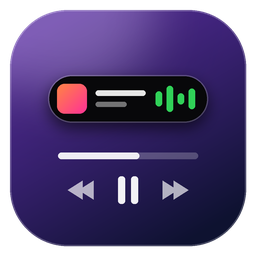

<p align="center">
  
</p>

<h1 align="center">FlowIsland</h1>

<p align="center">
  A lightweight, Dynamic Island–style widget for Windows 10 &amp; 11.<br>
  Live music controls, quick launch and handy widgets – right at the edge of your screen.
</p>

<p align="center">
  <a href="../../releases/latest"><b>⬇ Download the latest version</b></a>
</p>

---

## ✨ Features

| | |
|---|---|
| 🎵 **Now Playing** | Song title, artist and album art from Spotify (or any media app). Play/pause, previous/next and a seekable progress bar. |
| 🎚️ **Clear playback state** | Animated equalizer while music plays – flat and dimmed when paused. |
| 🧩 **Tabs** | Music, Apps (quick-launch tiles for programs, folders and links) and a keyboard-shortcut cheat sheet. |
| 🕒 **Idle widgets** | When nothing is playing: date & time, clock, battery, CPU/RAM usage or a minimal dot. Switch with the mouse wheel. |
| 🖱️ **Move it anywhere** | Drag the island wherever you like. It snaps to the top center and docks flush against screen edges. |
| 📥 **Tuck into the edge** | Push it fully into an edge and it shrinks to a slim glowing handle. Click or drag it out to bring it back. |
| 🎨 **Fully customizable** | Solid, gradient or *Liquid Glass* style, 14 curated color presets, harmonious random palettes, custom fonts, size and corner radius. |
| ⚡ **Built for efficiency** | Event-driven (no constant polling), GPU-accelerated animations, optional RAM limiter, auto-hides during fullscreen games and videos. |
| 🔒 **Private by design** | No account, no login, no internet connection, no telemetry. Everything stays on your PC. |

---

## 🚀 Getting started

1. Download **`DynamicIsland.exe`** from the [latest release](../../releases/latest).
2. Put it in its own folder (e.g. `Documents\FlowIsland`) – settings are saved next to the file.
3. Double-click to start.

> **Windows SmartScreen:** Because the app is not signed with a paid certificate, Windows may show
> *“Windows protected your PC”* on first launch. Click **More info → Run anyway**.
> The full source code is in this repository, so you can verify exactly what it does.

To start FlowIsland automatically with Windows: double-click the island → **Einstellungen → Verhalten → Mit Windows starten** (Settings → Behavior → Start with Windows).

---

## 🖱️ Controls

| Action | How |
|---|---|
| Expand | Hover over the island (or click – configurable) |
| Menu | **Double-click** → Settings · Back · Close |
| Quick menu | **Right-click** |
| Move | Click and drag |
| Dock to an edge | Drop it close to a screen edge |
| Tuck away | Drag it all the way into an edge |
| Bring back | Click the handle or drag it out |
| Change idle widget | Mouse wheel over the collapsed island |
| Seek | Click or drag the progress bar |
| Open Spotify | Click the album art |

In the settings window: **↑ / ↓** scroll, **Page Up / Page Down** jump, **← / →** switch sections.

---

## ⚙️ Settings overview

- **Appearance** – presets, style, colors, gradient angle, opacity, accent color, size, corner radius, shadow, font
- **Behavior** – open on hover or click, delays, animation speed, edge docking, idle widget, RAM limiter, autostart, fullscreen auto-hide
- **Features** – turn Music, Apps, Shortcuts and Idle widgets on or off
- **Connections** – music source: Spotify only or all media apps
- **Apps / Shortcuts** – edit your quick-launch tiles and cheat sheet directly

### RAM limiter
FlowIsland measures its own memory needs: the **minimum** it requires to run and the **maximum** beyond which more memory brings no benefit. A slider lets you set a hard limit anywhere between those two values.

---

## 💻 Requirements

- Windows 10 (version 2004 or newer) or Windows 11, 64-bit
- No additional installation needed for the release `.exe`
- Interface language: German

---

## 🛠️ Build from source

Requires the [.NET 8 SDK](https://dotnet.microsoft.com/download/dotnet/8.0).

```powershell
# Standalone single-file .exe (runs without .NET installed)
dotnet publish src\DynamicIsland.csproj -p:PublishProfile=Teilen

# Smaller build (requires the .NET 8 Desktop Runtime)
dotnet publish src\DynamicIsland.csproj -c Release -r win-x64 --self-contained false -p:PublishSingleFile=true -o App
```

Every push and every `v*` tag is built automatically by **GitHub Actions** – tagged builds are attached to the release.

---

## 🧩 Extending with modules

Each part of the island is a module. To add your own tab:

1. Copy `src/Modules/BeispielModul.cs` (template) and rename the class.
2. Set `Enabled => true`.
3. Rebuild – the new tab appears automatically and can be toggled under **Settings → Features**.

Ideas: timer, weather, notes, to-do list, system stats.

---

## 📁 Project structure

```
src/
├── App.xaml / MainWindow.xaml     # the island window
├── Core/                          # settings, theming, animations, RAM limiter, Windows APIs
├── Modules/                       # Music, Apps, Shortcuts, Idle widgets (+ template)
└── Settings/                      # settings window (macOS-style)
.github/workflows/build.yml        # automatic builds & releases
```

---

<p align="center">
  Built with C# and WPF · Inspired by Apple's Dynamic Island · Not affiliated with Apple Inc.
</p>
